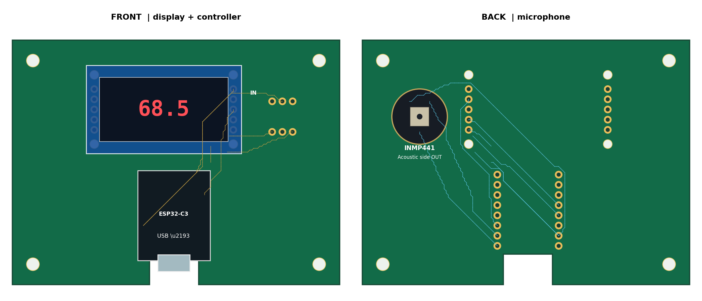

# ESP32-C3 数字分贝检测器（INMP441 + 74HC595）

**PCB REV4 集成版 · 固件 v2.2 · 探测程序 v3 · 2026-10**

> **定位**：DIY 环境噪声监测与学习项目。它输出的是**估算 dB(A)**，不是经检定/校准的标准声级计，不能用于噪声合规判定或法律用途。



## 快速开始

1. 把 ESP32-C3 插进 U1-L/U1-R 两个 2×8 母座：**USB-C 朝下、芯片朝自己、5V 在左下角**。显示屏装到正面 JDISP_IN / JDISP_AUX，麦克风装到背面 JMIC。**先核对显示屏 5 脚顺序**（板上丝印：`LCD: CHECK INPUT PAD ORDER`），接反 VCC/GND 可能损坏模块。
2. Arduino IDE：安装 `esp32 by Espressif Systems` 3.x，板子选 `ESP32C3 Dev Module`，**Tools → USB CDC On Boot → Enabled**。
3. 烧 `firmware/Display_595_Probe`，看数码管：每组 profile 先显示 `1234`，再显示四位 `0/1`。找到 `1234` 正确的那组，记下四位。
4. 把四位填进主程序的四个 `constexpr bool`，必要时再填 `SEGMENT_MAP`，烧 `firmware/SoundMeter_595_ESP32C3`。
5. 接上麦克风，串口应出现 `A_est` / `Z_est` / `rmsA` / `rmsZ`；说话或拍手时数值应明显变化。

## 1. 能做什么

- INMP441 以 I²S **48 kHz、32-bit 槽、立体声**采集；`L/R` 接地，只使用左声道。
- ESP32-C3 计算**估算 A 计权声级**（dB(A)）和未计权声压级（Z），每 0.5 s 刷新四位数码管，同时从串口输出 A/Z/RMS。
- 显示驱动是**两片级联 74HC595**（一片段码、一片位选），不是 TM1637；不需要 TM1637 库。
- 显示极性、字节顺序、数字左右顺序、段码脚位都可配置；附带探测程序帮助确定。
- PCB 为**半集成载板**：ESP32 仍插在正面 2×8 母座；显示屏和麦克风直接装在 PCB 的焊盘/插座上，不再使用 J1/J2 短线。USB-C 从底边缺口朝外，麦克风在背面拾音。

## 2. 当前状态

| 项目 | 状态 |
|---|---|
| 显示屏 + 595 驱动 | 实物调通 |
| INMP441 I²S 采集 | 实物调通 |
| 串口 A/Z/RMS 输出 | 实物调通（需 `USB CDC On Boot = Enabled`） |
| 绝对声压级校准 | **未做**，`CALIBRATION_OFFSET_DB = 0` |
| PCB REV4 打样 / KiCad DRC / 嘉立创 DFM | **未做** |
| 外壳、USB 插头外壳宽度、排针高度 | **未实测** |

测量不确定度主要来自：INMP441 灵敏度公差 ±3 dB、约 33 dB(A) 的等效输入噪声、近似的 A 计权、未校准、供电/显示耦合。**不要把绝对读数和标准限值直接比较。**

## 3. 硬件

### 3.1 物料

| 材料 | 数量 | 说明 |
|---|---:|---|
| ESP32-C3 SuperMini | 1 | USB-C，优先已焊排针版 |
| INMP441 I²S 麦克风模块 | 1 | 6 引脚，**只用 3.3V** |
| 四位 LED 数码管模块 | 1 | 两片 74HC595 级联；按实物引脚 |
| PCB REV4 | 1 | 81.28 × 60.96 mm，双层 1.6 mm |
| 1×8 母排针 | 2 | 2.54 mm，排距 15.24 mm |
| 1×5 母排针 | 2 | 显示屏两排 5 孔 |
| 6 根短线或对应插座 | 1 | 麦克风 JMIC（2×3 焊盘） |
| M2.2 螺丝 + 绝缘柱 | 4 | 显示屏定位 |
| M3 螺丝 + 绝缘柱 | 4 | 主板固定 |
| 杜邦线 | 若干 | 显示屏/麦克风转接 |
| USB-C **数据**线 | 1 | 能烧录的线 |
| 100 nF + 10 µF | 可选 | 供电/显示干扰大时加在 3.3V 附近 |

本项目没有独立的 `BOM.csv`/`netlist.csv`；板级连接以 PCB 丝印和本文表格为准，具体排针/座子按你手里的模块选。

### 3.2 显示屏：JDISP_IN / JDISP_AUX

正面显示屏区域有两排 5 孔：

- 右侧 **JDISP_IN** 是电气连接（从上到下）：

  | JDISP_IN | 信号 | ESP32-C3 |
  |---:|---|---|
  | 1 | VCC | 3V3 |
  | 2 | SCLK | GPIO7 |
  | 3 | RCLK | GPIO10 |
  | 4 | DIO | GPIO3 |
  | 5 | GND | GND |

- 左侧 **JDISP_AUX** 的 5 个孔**没有连接任何网络**，只作机械支撑/备用；不要把它当电源或信号。
- 四角有 4 个 **M2.2** 定位孔，对应显示屏模块的安装柱。

> **板上丝印明确写着 `LCD: CHECK INPUT PAD ORDER`。** 插屏前逐脚核对显示模块的 5 脚顺序是否与 `VCC/SCLK/RCLK/DIO/GND` 一致；不一致必须做转接/换线序，**不能硬插**，否则可能把 VCC 和 GND 接反。

### 3.3 麦克风：背面 JMIC

背面 `JMIC` 是 2×3 焊盘，按背面丝印逐脚连接：

| 位置 | 信号 | ESP32-C3 |
|---|---|---|
| 上排 | GND | GND |
| 上排 | VDD | 3V3 |
| 上排 | SD | GPIO6 |
| 下排 | L/R | GND |
| 下排 | WS | GPIO5 |
| 下排 | SCK | GPIO4 |

- INMP441 的 `L/R` 必须接 GND（选左声道）；悬空会导致声道错位或无声。
- 麦克风装在**背面**，声孔朝外；丝印：`MIC BACK ONLY` / `PORT FACES OUT`。
- 如果模块引脚间距和 JMIC 不一致，用短线按丝印连接，不要强行弯脚。

### 3.4 ESP32-C3 安装方向（关键）

拿起 PCB **正面朝自己，USB-C 指向下方底边的缺口**，开发板的**芯片也朝自己**。此时两侧从上到下的引脚应为：

| 排针位置 | 左侧 U1-L | 右侧 U1-R |
|---:|---|---|
| 1 | GPIO0 | GPIO21 |
| 2 | GPIO1 | GPIO20 |
| 3 | GPIO2 | GPIO10 |
| 4 | GPIO3 | GPIO9 |
| 5 | GPIO4 | GPIO8 |
| 6 | 3V3 | GPIO7 |
| 7 | GND | GPIO6 |
| 8 | 5V（不接） | GPIO5 |

即 **5V 应落在左下角**。安装前按实物丝印再确认一次；插反可能把 5V 灌到 GPIO/3V3，损坏模块。

### 3.5 电源与地

- INMP441 和显示逻辑都用 **3.3V**；不要把 5V 接到 INMP441 或显示模块的信号侧。
- 显示模块即使标称 5V，也优先用 3.3V 测试：亮度会低一些，但 GPIO 电平安全。
- 所有模块共地；电源轨先确认导通。
- 5V 焊盘不接任何模块，板子由 ESP32 的 USB-C 供电。

## 4. PCB REV4（集成版）

- 外形：**81.28 × 60.96 mm**，双层 FR-4，1.6 mm，1 oz 铜。
- USB-C 避让缺口：底边 `x = 34.036～46.228 mm`，`y = 53.340～60.960 mm`，即 **12.192 × 7.620 mm**；缺口在 ESP32 正下方。
- 4 个 M3 孔：`(5.08,5.08)`、`(76.2,5.08)`、`(5.08,55.88)`、`(76.2,55.88)`，直径 3.2 mm。
- 显示屏 4 个 M2.2 孔：`(20.32,8.636)`、`(20.32,25.908)`、`(54.864,8.636)`、`(54.864,25.908)`。
- 显示屏两排 5 孔：右侧 `JDISP_IN`（电气）与左侧 `JDISP_AUX`（未连网络），孔距 2.54 mm。
- ESP32 2×8 母座：排距 15.24 mm，同列 2.54 mm，钻孔 1.0 mm。
- 麦克风 `JMIC`：背面 2×3 焊盘，2.54 mm 间距，两排相距 7.62 mm。

文件：

- `source/SoundMeter_Integrated_C3_595_REV4.kicad_pcb`：可编辑 KiCad PCB（**不含** `.kicad_sch` 原理图）。
- `gerber/`：9 个 Gerber / 钻孔文件，KiCad 默认命名（`SoundMeter-F_Cu.gtl`、`-B_Cu.gbl`、`-F_Mask.gts`、`-B_Mask.gbs`、`-F_Silkscreen.gto`、`-B_Silkscreen.gbo`、`-Edge_Cuts.gko`、`-PTH.drl`、`-NPTH.drl`）。
- `Gerber_打样前先核对.zip`：上面 9 个文件打好的包，可直接上传嘉立创。
- `preview/Integrated_PCB_Front_Back.png`：正反面安装预览。

> **REV4 相对 v3**：显示屏和麦克风改为板载安装，不再有 J1/J2 短线；板深从 55.88 增加到 60.96，USB 缺口移到 ESP32 下方并加深到 7.62 mm。**不能复用 v3 的 Gerber。**

制板前：

1. 在 KiCad 里跑一次官方 **DRC**；本项目尚未跑过。
2. 上传 Gerber 到嘉立创后，在 2D/3D 预览确认 **USB 缺口被识别成单块异形板**、钻孔和焊盘完整。
3. 用实物 USB-C 插头核对缺口宽度（约 12.19 mm）和插头塑胶外壳；用实物排针核对 ESP32 插座高度。
4. 用实物显示屏核对两排 5 孔的间距和 4 个 M2.2 定位孔；**先核对 5 脚顺序**。
5. 嘉立创参数：双层、FR-4、1.6 mm、1 oz、绿色阻焊、常规表面处理；**不贴片**，手工焊排针/母座。

## 5. 软件环境

- **Arduino IDE 2.x**。
- 开发板核心：`esp32 by Espressif Systems` **3.x**（3.0 及以上）。
- 开发板：`ESP32C3 Dev Module`。
- **Tools → USB CDC On Boot → Enabled**（关键）。
- 不需要 TM1637 库；`ESP_I2S.h` 随 ESP32 核心提供。
- 串口监视器 115200（原生 USB CDC 的“波特率”实际不影响通信，保持默认即可）。

### 为什么必须开 USB CDC On Boot

ESP32-C3 SuperMini 没有 CH340/CP2102，USB-C 直接接芯片内置的 **USB Serial/JTAG**：

| 设置 | `Serial` 连到 | 结果 |
|---|---|---|
| **Enabled** | USB Serial/JTAG（GPIO18/19） | 电脑出现虚拟串口，`Serial.print` 能到监视器 |
| Disabled | UART0（GPIO20/21） | USB 口收不到应用输出；监视器全空，发字符还可能把 IDE/USB 卡住 |

这是**编译期选项**（`ARDUINO_USB_CDC_ON_BOOT`），改完必须**重新上传**。打开后 COM 号可能变化，重新选端口；先打开串口监视器再按 RST，能抓到启动日志。

> 固件里的串口输出已改成**非阻塞**：监视器没开或端口不对时只是丢数据，不会再把设备卡死。但 `USB CDC On Boot` 仍然要开，否则根本收不到数据。

## 6. 调试步骤

### 6.1 只装显示屏：`Display_595_Probe`

先不装麦克风，烧 `firmware/Display_595_Probe`（显示屏装到 JDISP_IN，JDISP_AUX 可空）。

- 16 组 profile 自动轮换，每组 2.5 s：
  - 前 **1.0 s** 显示 `1234`；
  - 后 **1.5 s** 显示四位 `0/1`，顺序为：

    ```text
    SEG_LOW  DIGIT_HIGH  SEG_FIRST  REVERSE
    ```

- 看到 `1234` 从左到右正确显示时，记下紧接着的四位。例如显示 `1 0 1 0`：

  ```cpp
  constexpr bool SEGMENT_ACTIVE_LOW = true;
  constexpr bool DIGIT_ACTIVE_HIGH  = false;
  constexpr bool SEGMENT_FIRST      = true;
  constexpr bool REVERSE_DIGITS     = false;
  ```

- 如果 `1234` 显示成 `4321`，按 `4` 翻转 `REVERSE_DIGITS`；如果四位全亮，按 `2` 翻转位极性；如果七段全亮，按 `1` 翻转段极性；如果段和位明显串了，按 `3` 翻转字节顺序。

**段码脚位不是标准 Q0=a…Q7=dp 时**：

- 串口发 `s` 进入段扫描，每 1.5 s 换一个原始段输出 `Q0…Q7`；
- 记下每个 `Qn` 实际点亮的是 `a/b/c/d/e/f/g/dp` 哪一段；
- 填主程序的 `SEGMENT_MAP`（方向是**逻辑段 → Q 编号**）：

  ```cpp
  // 例：Q0→dp, Q1→g, Q2→f, Q3→e, Q4→d, Q5→c, Q6→b, Q7→a
  constexpr uint8_t SEGMENT_MAP[8] = {7,6,5,4,3,2,1,0};
  ```

- 串口不可用时，数码管仍会自动显示四位的 profile 结果，**不依赖串口输入**；段扫描才需要串口命令。

可选串口命令：

| 键 | 作用 |
|---|---|
| `1` | 翻转 `SEGMENT_ACTIVE_LOW` |
| `2` | 翻转 `DIGIT_ACTIVE_HIGH` |
| `3` | 翻转 `SEGMENT_FIRST` |
| `4` | 翻转 `REVERSE_DIGITS` |
| `s` | 段扫描 Q0～Q7 |
| `d` | 位扫描 D0～D3 |
| `x` | 冻结当前 profile |
| `p` | 重新开始自动轮换 |
| `h` | 帮助 |

### 6.2 烧主程序：`SoundMeter_595_ESP32C3`

1. 把 6.1 得到的四个常量填进主程序顶部；非标准段序再填 `SEGMENT_MAP`。
2. 烧录。上电会显示 `8888` 约 0.5 s，然后清屏；前 1 秒是滤波器预热，约 1.5 秒后出第一个数。
3. 串口应出现类似：

```text
ESP32-C3 / INMP441 / 74HC595 sound meter (estimated, not certified)
Display profile: segmentLow=1 digitHigh=1 segmentFirst=1 reverseDigits=0
Segment map a..dp -> Q0,1,2,3,4,5,6,7
Sound display: estimated dB(A), rate=48000Hz, calibration offset=0.0 dB
A_est=62.3 dB(A)  Z_est=64.7 dB SPL  rmsA=0.000...  rmsZ=0.000...
```

4. 装好麦克风，对着它说话或拍手：`rmsZ` 应明显变化，`A_est`/`Z_est` 跟着上升。安静房间读数大约 30～40 dB(A) 是正常的（INMP441 自噪声约 33 dB(A)），不要强行清零。

### 6.3 串口没有输出 / IDE 卡住

1. 确认 **Tools → USB CDC On Boot = Enabled**，重新上传。
2. 拔插 USB，重新选 COM 口；ESP32-C3 原生 USB 有时会出现两个端口，换另一个试。
3. 先打开串口监视器，再按板子 RST（或拔插 USB），让启动横幅在监视器已打开时打印。
4. 确认选的是应用的 USB CDC 口，而不是下载模式/其他串口。
5. 如果旧版 ESP32 核心在输入字符时仍卡住：升级到最新 3.x（新版 `HWCDC` 对 USB 写有超时保护）；或干脆不发串口命令，直接用数码管显示的四位 profile。

## 7. 固件配置

修改 `firmware/SoundMeter_595_ESP32C3/SoundMeter_595_ESP32C3.ino` 顶部后重新编译上传：

| 常量 | 默认 | 说明 |
|---|---|---|
| `SEGMENT_ACTIVE_LOW` | `true` | 段输出低电平点亮 |
| `DIGIT_ACTIVE_HIGH` | `true` | 位选高电平点亮 |
| `SEGMENT_FIRST` | `true` | 先发送段码字节 |
| `REVERSE_DIGITS` | `false` | 位选 bit3 为最左位 |
| `SEGMENT_MAP[8]` | `{0,1,2,3,4,5,6,7}` | 逻辑 `a..dp` → 原始 `Q0..Q7` |
| `SHOW_A_WEIGHTED` | `true` | `true` 显示 A 计权；`false` 显示未计权 |
| `CALIBRATION_OFFSET_DB` | `0.0` | 没有参考仪器时保持 0 |
| `SAMPLE_RATE_HZ` | `48000` | A 计权系数按 48 kHz 设计 |
| `DISPLAY_INTERVAL_MS` | `500` | 显示/统计窗口 |

**不要单独把 `SAMPLE_RATE_HZ` 改成 16000 或 32000** 而不重新设计 A 计权 SOS 系数；滤波器系数与采样率绑定。需要 LAeq/峰值/长时间平均时，应改统计窗口与算法，而不是改采样率。

## 8. 分贝是怎么算出来的

INMP441 手册：1 kHz、94 dB SPL 正弦，灵敏度典型 **−26 dBFS**（−29 / −26 / −23 dBFS，±3 dB）；该 dBFS 按**峰峰值**相对满量程定义。对正弦，归一化 RMS 为：

```text
RMS_94 = 10^(-26/20) / sqrt(2) ≈ 0.035439
SPL_est = 94 + 20*log10(RMS / RMS_94) + CALIBRATION_OFFSET_DB
```

- 32 位 I²S 槽里的 24 位有符号数据左对齐，`sample / 2^31` 归一化到约 −1～1。
- 除以 √2 很关键：把峰值当 RMS 会差约 3.01 dB。
- A 计权用 3 个二阶 IIR 节（SOS）近似，1 kHz 归一到 0 dB；48 kHz 下与 IEC A 计权在 8 kHz 以内偏差约 0.5 dB 以内，12 kHz 约 −2.3 dB、16 kHz 约 −6.4 dB（双线性变换的高频误差）。它是**近似实现**，不等于标准声级计。
- 未计权路径只做了一阶 DC 去除，不是标准 Z 计权。
- 典型自噪声 33 dB(A)，灵敏度 ±3 dB；没有参考仪器时，绝对读数只能当估算值。

### 校准与“最低 46 dB”

- 没有声级计/94 dB 声校准器时，`CALIBRATION_OFFSET_DB` 保持 0；不要把手机 App 当校准基准（手机麦克风也有偏差）。
- 46 dB(A) 在普通居家环境不算异常：安静卧室 30～40，普通客厅/书房 40～50，有电脑风扇/冰箱/空调 45～55。
- 想判断是环境声还是设备电噪：轻轻捂住麦克风声孔（读数明显下降=环境声）；换房间/关电器；断开显示屏再测（明显下降=显示/供电耦合）；换 USB 供电（充电宝 vs 电脑）。
- 显示的是 0.5 s 的瞬时 A 计权值，不是长时间最小值；观察时间太短会把间歇声当成“底噪”。

## 9. 常见问题

| 现象 | 可能原因 | 处理 |
|---|---|---|
| 烧录找不到 COM | 线是充电线、驱动、启动模式 | 换数据线 → 选端口 → 按住 BOOT 再复位 |
| 串口全空 | `USB CDC On Boot` 未开、端口错 | 开 CDC、重新上传、重选端口 |
| 输入字符后 IDE 卡死 | 旧核心 USB CDC 写阻塞 | 升级核心；本版固件已非阻塞；用数码管读 profile |
| 开机不显示 | 显示不是两片 595、供电/接线错 | 先烧探测程序，查 VCC/GND/SCLK/RCLK/DIO |
| 数码管乱码 | profile 不对、段序非标准 | 用 `1234`+四位 bits 找 profile；`s` 段扫描填 `SEGMENT_MAP` |
| 数字左右反了 | `REVERSE_DIGITS` 反 | 按 `4` 或改常量 |
| 只有一位亮 / 四位全亮 | 位极性/位选错 | 按 `2`、`d` 位扫描 |
| 数字很暗 | 3.3V 供电、模块按 5V 设计 | 确认允许 3.3V；不要为亮度把逻辑接 5V |
| `FATAL: I2S setup failed` | 核心版本/引脚/资源 | 核心 3.x、ESP32C3 Dev Module、检查 GPIO4/5/6 |
| `ERROR: no I2S samples` | 麦克风焊盘/连线断、`L/R` 错、供电 | 查 VDD/GND/SCK/WS/SD，`L/R` 接 GND |
| `audio near-zero` | 左声道没数据、`L/R` 悬空、声孔堵 | 查 `L/R`、SD、麦克风声孔 |
| 安静时总有 30 多 dB | INMP441 自噪声 | 正常限制，不应清零 |
| 读数偏高/偏低 | 未校准 ±3 dB、电噪、低频环境声 | 看 `Z_est`；做第 8 节的三步测试 |
| 显示闪烁 | 刷新任务被阻塞/供电不稳 | 确认单核任务正常运行；查 3.3V 和 GND |
| 上电重启/数字乱闪 | USB 电源、接触不良、屏电流大 | 换 USB 口/线，降低亮度（硬件），查电源轨 |

## 10. 文件结构

```text
DecibelDetector/
├── README.md
├── .gitignore
├── Gerber_打样前先核对.zip
├── firmware/
│   ├── Display_595_Probe/
│   │   └── Display_595_Probe.ino
│   └── SoundMeter_595_ESP32C3/
│       └── SoundMeter_595_ESP32C3.ino
├── gerber/
│   ├── SoundMeter-F_Cu.gtl
│   ├── SoundMeter-B_Cu.gbl
│   ├── SoundMeter-F_Mask.gts
│   ├── SoundMeter-B_Mask.gbs
│   ├── SoundMeter-F_Silkscreen.gto
│   ├── SoundMeter-B_Silkscreen.gbo
│   ├── SoundMeter-Edge_Cuts.gko
│   ├── SoundMeter-PTH.drl
│   └── SoundMeter-NPTH.drl
├── preview/
│   └── Integrated_PCB_Front_Back.png
└── source/
    └── SoundMeter_Integrated_C3_595_REV4.kicad_pcb
```

> 每个 `.ino` 必须放在同名文件夹里，Arduino IDE 才能直接打开。

## 11. 制板与装配注意

- **USB 缺口**约 12.19 mm 宽、7.62 mm 深；部分 USB-C 线材的塑胶外壳更宽，打样前用实物插头 1:1 比对，必要时加宽缺口后重新导出 Gerber。
- ESP32 排针高度、USB 母座到模块底边的偏移量未实测；装配前先空板试插。
- **显示屏 5 脚顺序**必须逐脚核对（板上丝印已经提醒）；`JDISP_AUX` 不连网络，只作机械支撑。
- 麦克风装在背面，声孔朝外并对外壳开孔；**不要用热熔胶/导电胶覆盖**。
- 显示屏/麦克风若用短线转接，线长 10～20 cm 以内；I²S BCLK 为 3.072 MHz，线太长容易出错。
- 显示/麦克风供电不稳时，在 3.3V 与 GND 之间加 100 nF + 10 µF 去耦；麦克风地线尽量单独回板。
- 板子用 M3 绝缘柱固定，显示屏用 M2.2 柱固定；避免麦克风与数码管/外壳机械振动耦合。

## 12. 参考

1. [TDK / InvenSense INMP441 数据手册](https://product.tdk.com/system/files/dam/doc/product/sw_piezo/mic/mems-mic/data_sheet/inmp441.pdf) — 灵敏度、24 位左声道 I²S、3.2 MHz 上限、dBFS 定义。
2. [Espressif Arduino-ESP32 I²S API](https://docs.espressif.com/projects/arduino-esp32/en/latest/api/i2s.html) — `ESP_I2S.h`、`setPins`、`begin`、`readBytes`。
3. [TI SN74HC595 数据手册](https://www.ti.com/lit/ds/symlink/sn74hc595.pdf) — 移位寄存器/锁存时序。
4. [Apache NuttX ESP32-C3 SuperMini 引脚文档](https://github.com/apache/nuttx/blob/master/Documentation/platforms/risc-v/esp32c3/boards/esp32c3-supermini/index.rst) — SuperMini 排针位置参考。

## 13. 免责声明

本项目是学习/DIY 项目，**不是**经检定或校准的声级计，不满足 IEC 61672 Class 1/2，不能用于噪声合规、职业健康或法律用途。作者不对因使用本项目造成的任何损失负责。测量结果受麦克风个体差异、供电、结构、校准和环境声影响；需要准确声压级时，请使用经过校准的声级计。
